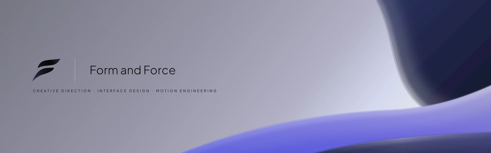

<div align="center">

<picture>
  <source media="(prefers-color-scheme: dark)" srcset="brand/applications/github/form-and-force-banner-dark.webp">
  
</picture>

<h3>Creative direction, interface design and motion engineering for coding agents</h3>

An Agent Skill and Claude Code plugin that deals a direction, draws it, builds it in your stack,<br>
and judges the rendered page against the one any competent agent would have made.

[](https://github.com/erenthedeveloper0/form-and-force/actions/workflows/ci.yml)
[](CHANGELOG.md)
[](docs/installation.md)
[](docs/reference/compatibility.md)
[](docs/reference/tools.md)
[](docs/reference/configuration.md)
[](LICENSE)

[Documentation](docs/README.md) · [Quick start](docs/quick-start.md) · [How it works](docs/how-it-works.md) · [Changelog](CHANGELOG.md) · [Roadmap](ROADMAP.md) · [Contributing](CONTRIBUTING.md)

</div>


> [!IMPORTANT]
> **Pre-1.0, and not yet measured.** The method and its tools are complete and tested, but the
> model evaluations that would show whether the skill improves an agent's work have not been run
> on any release. Read [Status](#status) before relying on it.

```bash
claude plugin marketplace add erenthedeveloper0/form-and-force
claude plugin install form-and-force@form-and-force
```

Then describe the work in Claude Code, in your own words:

```text
Our pricing page looks like every SaaS template. Redesign it around how
accountants actually compare plans. Keep the existing Next.js stack.
```

Before anything is designed, a script deals each key frame its cards, so the choice that decides
distinctiveness is not left to the model's taste. This is an excerpt of the dealer's real output for
a Composed project that has an interface and data to show:

```text
$ node skills/form-and-force/scripts/deal.mjs hand --register composed --has ui,data --seed readme --no-history
Hand for register COMPOSED: Clear, with a point of view.
  …
FRAME A
  Lens: The unsaid  [truth]
    What does every organisation in this category avoid showing or saying: the price, the
    limits, the mess before, the queue, the failure rate, the back room? Lead with it.
    …
  Structure: Strip  [sequence]
    …
  Lead medium: The working thing
    …
FRAME B
  Lens: Invert the convention  [inversion]
  Structure: Console  [field]
  Lead medium: Real data
  …
FRAME C
  Lens: Change the tone of voice  [viewpoint]
  Structure: Specimen  [mass]
  Lead medium: Drawn in code
  …
```

Three frames from three different families, and not a word about colour or type. The agent answers
each card from facts about your project, sketches all three as real pages, and chooses by looking at
them side by side. Then it builds, clears ten hard gates, and judges what it built.

**Contents**: [The idea](#the-idea) · [How it works](#how-it-works) · [What is inside](#what-is-inside) ·
[Tools](#tools) · [Install](#install) · [Quick start](#quick-start) · [Status](#status) ·
[Validate](#validate) · [Layout](#layout) · [Documentation](#documentation) · [Contributing](#contributing)


## The idea

> Decide by looking. Judge what was built.

An agent's design work is usually competent and predictable: a centred hero, three cards, a violet
gradient, a fade-up on every section. Telling it to be original moves it to the most typical
original thing. The [research](research/CREATIVE_METHOD.md) traces this to three causes, and Form &
Force answers each with a mechanism instead of an instruction:

| Cause | Mechanism |
| --- | --- |
| Asked to choose, a model chooses the most typical thing, including the most typical "original" one | The choices that decide distinctiveness are **dealt** by a script, at random, away from what recent projects used |
| Directions described in prose sound different and render the same | A direction is **drawn** before it is chosen: rough frames, rendered side by side, chosen by looking |
| Whoever wrote the rationale finds the result convincing | The work is **judged cold**, from screenshots, against the page anyone would have made |

The skill has no look of its own. A public-service form, a trading dashboard and an immersive launch
each get their own answer, and three projects made with it should not resemble one another.

The mark is the same idea: two strokes travelling the same way, one drawing the form, the other
carrying the force. A form is what a force leaves behind.


## How it works

```text
read → register → twin → hand → sketches on a board → commit
     → derive the language from the chosen frame → build
     → floor (hard gates) → jury (rendered evidence) → ship | refine | rework | redirect
```

1. **Read** the repository and the subject: the stack, the real proof, the material in hand, fifteen or more concrete facts.
2. **Set the register** (Quiet, Composed, Expressive or Radical) and write down **the twin**: the page any competent agent would make.
3. **Deal a hand**: a lens, a compositional structure and a lead medium for each key frame.
4. **Sketch** each frame, put them on one board, and **choose by looking**.
5. **Derive** composition, type, colour, imagery and motion from the chosen frame, and **build** in the project's stack.
6. **Clear the floor**: ten pass-or-fail gates for accessibility, function, responsiveness, performance and honesty.
7. **Sit the jury** on the rendered page: a cold read, a test against the twin, ten dimensions marked with evidence, and a verdict that can send the work back to the idea.

The loop scales to the job: a one-line fix gets a short pass, a flagship site gets all of it. Every
step and every word the method uses is explained in [How it works](docs/how-it-works.md).

## What is inside

| Part | What it gives the agent | Read more |
| --- | --- | --- |
| Creative direction | A deck of 26 lenses and 17 structures dealt away from recent projects; directions written as *a fact, therefore a rule you could see in a screenshot* | [Guide](docs/guides/creative-direction.md) |
| Visual exploration | Key frames sketched as standalone pages and compared wide, narrow and blurred, with a measure of whether they really differ | [Guide](docs/guides/visual-exploration.md) |
| Design language | Composition, typography, colour, imagery, coded visuals and design-system tokens, derived from the chosen frame | [Guide](docs/guides/design-language.md) |
| Motion | A gate that can say no, one character that generates every duration and curve, a designed reduced-motion version, and a filmstrip of the result | [Guide](docs/guides/motion.md) |
| Component atlas | 180 components with their job, states, behaviour and tests, searched one at a time, never copied | [Reference](docs/reference/component-atlas.md) |
| The floor | Ten hard gates: WCAG 2.2 AA, no overflow, visible focus, reduced motion, real controls, no fabricated proof, performance budgets | [Guide](docs/guides/quality.md) |
| The jury | A cold read from the first screen, the twin test, ten dimensions with evidence, and four verdicts | [Guide](docs/guides/quality.md#the-jury) |

Every decision cites a fact about the subject. Nothing is invented: missing testimonials, logos and
numbers become labelled slots. The agent works in your stack and keeps your uncommitted work, and its
report says what ran, what passed and what was not verified.


## Tools

Eight command-line tools ship inside the skill. They are free, offline and need nothing beyond Node;
the four rendered tools also use a local Playwright.

| Tool | Stage | Browser | What it does |
| --- | --- | --- | --- |
| `inspect_repo` | Read | No | Inventories the stack, tokens, routes, motion code and uncommitted work, without opening secret files |
| `slop_scan` | Read, floor | No | Finds failures and default patterns in source and templates, and states what it did not read |
| `deal` | Direct | No | Deals lenses, structures and media, and remembers what recent projects committed to |
| `motion_tokens` | Derive | No | Generates durations, curves, a spring, travel and stagger from one motion character |
| `sketch_board` | Direct | Yes | Renders sketches side by side, wide, narrow and blurred, and measures whether they differ |
| `audit_page` | Floor, jury | Yes | First screen, flatplan, design facts, keyboard walk, reduced motion, overflow, LCP and CLS |
| `motion_strip` | Jury | Yes | A moment in slow motion as a filmstrip, interrupted and reversed, with what really animated |
| `contact_sheet` | Jury | Yes | Any folder of screenshots as one labelled sheet |

Every tool prints its usage with `--help`. Arguments, outputs and exit codes are in the
[tools reference](docs/reference/tools.md).


## Install

**Claude Code plugin, from GitHub** (recommended):

```bash
claude plugin marketplace add erenthedeveloper0/form-and-force
claude plugin install form-and-force@form-and-force
```

From a local clone, add the path instead: `claude plugin marketplace add ./form-and-force`. For one
session without installing: `claude --plugin-dir ./form-and-force`.

**Standalone skill.** Download `form-and-force-<version>.zip` from the
[latest release](https://github.com/erenthedeveloper0/form-and-force/releases/latest) and upload it
in claude.ai or through the Skills API, or copy `skills/form-and-force` into `~/.claude/skills/`.

**Rendered tools** (optional). The sketch board, the audit and the motion strip need Playwright with
Chromium, installed in your project or a scratch directory, never globally:

```bash
mkdir -p ~/.cache/ffpw && cd ~/.cache/ffpw && npm i playwright && npx playwright install chromium
export FF_PLAYWRIGHT_DIR=~/.cache/ffpw
```

Without them the method runs on written frames and static checks, and its report says so. Updating,
removing and Windows commands are in [Installation](docs/installation.md).

## Quick start

With the plugin installed, describe the work. Claude loads the skill when the request is about
designing, building, animating or reviewing a web interface, or you can invoke it directly as
`/form-and-force:form-and-force`.

```text
Design and build the launch site for our ceramics studio. We have photographs
of twelve pieces and our kiln logs. Nothing else is decided.
```

Claude inventories the repository, sets a register, deals and sketches directions, and shows you the
board before building. After the build it clears the floor, judges the rendered page, and reports
every command it ran with its actual result. A review works too: *"Audit this page. Change nothing
yet."*

The tools also run on their own:

```bash
node skills/form-and-force/scripts/inspect_repo.mjs path/to/project
node skills/form-and-force/scripts/slop_scan.mjs path/to/project --strict
node skills/form-and-force/scripts/motion_tokens.mjs --action glide --flow bound
```

More in the [Quick start](docs/quick-start.md).


## Status

**0.2.2, pre-1.0.** The method, the references and the tools are complete and covered by tests.
What is missing is evidence that the method improves outcomes.

### Working today

- **The full method**, from reading the subject to the jury's verdict, routed by `SKILL.md` so a
  small fix reads little and a full site reads everything it needs.
- **18 references** covering direction, composition, typography, colour and imagery, creative
  coding, motion, experience flow, components, accessibility, responsive design, performance and
  security, and **5 templates** the agent fills in.
- **Eight tools** with one command-line contract, four of them working in a real browser.
- **A distribution** that installs as a Claude Code plugin from GitHub or a clone, and builds a
  standalone ZIP that is byte-for-byte reproducible.

### Verified

| Surface | Status |
| --- | --- |
| Claude Code plugin, from GitHub | Install verified with Claude Code 2.1.322 at 0.2.1 (2026-11-12) |
| Claude Code plugin, from a local clone | `claude plugin validate --strict .` passes, and install verified at 0.2.2 with Claude Code 2.1.325 (2026-11-16) |
| Personal or project skill | Structure validated |
| claude.ai upload or Skills API | The ZIP builds, verifies and reproduces; upload not tested |

Details, runtimes and known limits are in [Compatibility](docs/reference/compatibility.md).

### Limitations

- **No measured efficacy yet.** The model evaluations have not been run on any release. The case for
  the method is argued in the [research](research/CREATIVE_METHOD.md), not measured.
- **No process produces taste.** The method makes divergence, looking and rejection unavoidable. It
  cannot guarantee a good idea, and it does not promise awards.
- **Checks are heuristics.** The scan and the audit raise candidates and questions; they do not
  certify accessibility or field performance ([instrument calibration](research/INSTRUMENT_CALIBRATION.md)).
- **The rendered tools need a browser.** Heavy WebGL can stall headless, and a filmstrip cannot show
  how motion feels at speed or under a thumb.
- **A local history.** The dealer keeps card ids, typeface names and a one-line device per project in
  `~/.form-and-force/history.json`, keyed by a hash of the path. Nothing is sent anywhere;
  `--no-history` turns it off.
- **Not tested yet:** loading in a live session, the claude.ai upload, the Skills API and Windows.
  The [roadmap](ROADMAP.md) orders them.
- **Web only.** Native iOS and Android are out of scope.


## Validate

Every required check is free and offline. Python 3.11 or newer is the only requirement; with Node 18
or newer the tool tests run too.

```bash
python3 tooling/validate_repository.py     # structure, manifests, licence, links, workflows, media provenance
python3 -m unittest discover -s tests -v   # the suites below
python3 tooling/package_skill.py           # builds and verifies the standalone ZIP
python3 site/build.py --check              # builds the documentation site and checks every link
```

CI runs the same commands on every pull request, and `python3 tooling/release_check.py` prints the
release checklist.

### What the tests cover

| Suite | What it proves |
| --- | --- |
| `test_validate_repository.py` | Every validator rule fires on a deliberately broken copy of the repository |
| `test_validate_skill.py`, `test_package_skill.py` | The skill meets the Agent Skills rules; the ZIP holds exactly the skill and is reproducible |
| `test_skill_scripts.py` | The static scan on real fixtures and generated projects, and every tool's command-line contract |
| `test_creative_method.py` | The deck, the dealer, the motion tokens, the design-fact thresholds, and that documents and tools agree |
| `test_library.py` | Every atlas entry has its fields in order, and every reference's contents match its sections |
| `test_brand.py`, `test_site.py` | Brand provenance and contrast; the Markdown renderer and a full site build |
| `test_rendered_tools.py` | The audit, the sketch board and the motion strip in a real browser (when Playwright is available) |

## Optional model evaluations

The suite in `evals/` runs real Claude sessions with and without the plugin and grades them. Every
session and every judge-graded check is billed, so it never runs in CI or from any other command:

```bash
python3 tooling/evals.py                                                          # free: what would run and what it costs
python3 tooling/evals.py run --confirm-paid --max-cost-usd 5 --runs 1 --scaffold  # paid
```

Its status is **not run**. See [Testing](docs/development/testing.md) for the four kinds of
verification, from free tests to human judgement.


## Layout

```text
skills/form-and-force/   the skill: everything that ships to users
  SKILL.md               the operating manual
  references/            18 references: method, craft, motion, components, engineering
  scripts/               8 tools, 2 shared modules and the deck
  assets/                5 templates the agent fills in
.claude-plugin/          plugin manifest, one-plugin marketplace, listing icon
docs/                    the documentation, readable here and built into the site
site/                    the documentation site's builder and theme
brand/                   the identity: sources, guidelines and generated files
research/                the sources and measurements behind the method
tests/  evals/           free tests and fixtures; optional paid evaluations
tooling/                 validation, packaging, release gate, docs sync
```

Only `skills/form-and-force/` and `.claude-plugin/` reach users. Why the repository is organised this
way is in [ARCHITECTURE.md](ARCHITECTURE.md).

## Documentation

- **Start:** [Introduction](docs/introduction.md) · [Installation](docs/installation.md) ·
  [Quick start](docs/quick-start.md) · [How it works](docs/how-it-works.md)
- **Guides:** [Creative direction](docs/guides/creative-direction.md) · [Visual exploration](docs/guides/visual-exploration.md) ·
  [Design language](docs/guides/design-language.md) · [Motion](docs/guides/motion.md) ·
  [Building](docs/guides/building.md) · [The floor and the jury](docs/guides/quality.md) ·
  [Reviewing existing work](docs/guides/reviewing.md)
- **Reference:** [Tools](docs/reference/tools.md) · [Reference library](docs/reference/library.md) ·
  [Component atlas](docs/reference/component-atlas.md) · [The deck](docs/reference/deck.md) ·
  [Templates](docs/reference/templates.md) · [Configuration](docs/reference/configuration.md) ·
  [Troubleshooting](docs/troubleshooting.md)
- **Project:** [Architecture](ARCHITECTURE.md) · [Testing](docs/development/testing.md) ·
  [Extending](docs/development/extending.md) · [Releasing](docs/development/releasing.md) ·
  [Brand](brand/README.md) · [Research](research/README.md)

The same pages build into a website with search: `python3 site/build.py --serve`.


## Contributing

Contributions are welcome, and none of them needs a paid service. [CONTRIBUTING.md](CONTRIBUTING.md)
has the setup, the checks and the conventions; [SECURITY.md](SECURITY.md) explains how to report a
vulnerability privately, and [SUPPORT.md](SUPPORT.md) where to ask. Reports of poor design outcomes
are the most useful thing you can send. Three rules worth knowing up front:

1. **A claim needs evidence.** Documents say only what was checked, and a check that did not run is
   reported as not run, never as passed.
2. **The skill has no look of its own.** References hold questions and principles, never example
   palettes, typefaces or token values, and the project's own brand never enters the skill.
3. **Paid evaluations stay opt-in.** Every required check is free and offline.

## License

[MIT](LICENSE) © [Eren Sümer](https://github.com/erenthedeveloper0). The licence covers this
repository's code, documentation and artwork, not the third-party works the research cites. The
typefaces are listed in [THIRD_PARTY_NOTICES.md](THIRD_PARTY_NOTICES.md); contributors in
[CONTRIBUTORS.md](CONTRIBUTORS.md).

<br>

<div align="center">
  <picture>
    <source media="(prefers-color-scheme: dark)" srcset="brand/identity/lockup/form-and-force-horizontal-on-dark.svg">
    
  </picture>
  <br>
  <sub>Built by <a href="https://github.com/erenthedeveloper0">Eren Sümer</a> · decide, build, judge</sub>
</div>
