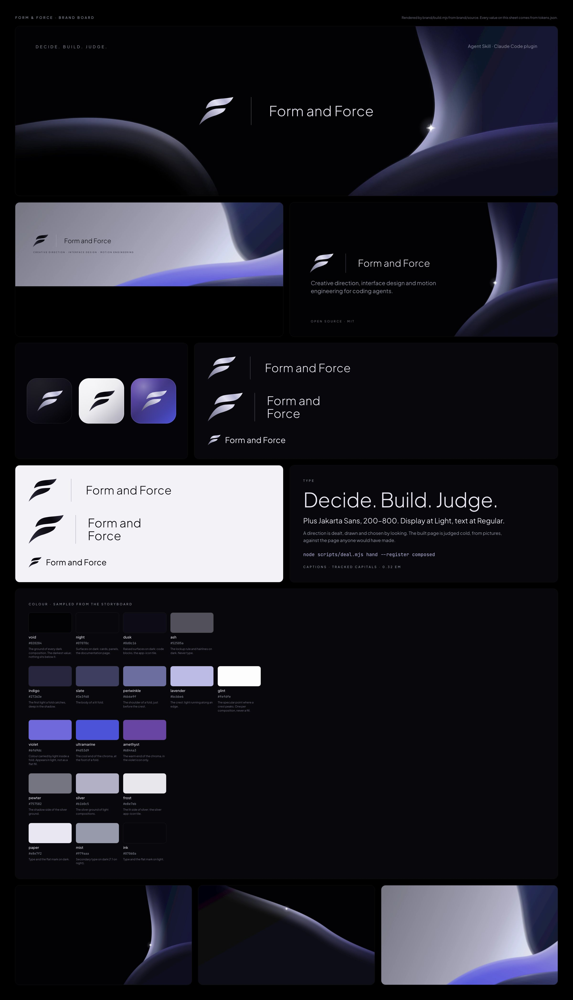

# Form & Force brand



This folder holds the identity of the Form & Force project: its logo, colour, type, graphics and every file made from them. It is the brand of the repository, the documentation, the plugin listing and the project's own materials.

**It is not a style for the work Form & Force helps make.** The skill has no look of its own and must never steer a user's project toward this one. Nothing in this folder ships in the skill, and the skill's references never mention it.

## The idea

The storyboard ([`source/storyboard.png`](source/storyboard.png)) shows dark sheets of something like silk, bent by a force you cannot see, with light running along their edges. The mark is an F made of two strokes moving the same way. Both images say the same thing as the name: **a form is what a force leaves behind.**

Four rules follow from it, and every asset obeys them:

1. **Light lives on edges.** Brightness appears only where a surface turns: the crest of a fold, the tip of a stroke. There are no glowing fills, no orbs and no light in the air.
2. **One light source.** In any composition, every crest and both strokes of the mark are lit from the same direction: from the lower left toward the upper right, along the mark's line of travel.
3. **Colour is carried by light.** Violet and ultramarine appear inside lit folds, never as flat panels or text.
4. **One glint, on a crest.** The four-point glint marks the single brightest point of a composition, and it sits on a crest. It never floats as an ornament.

Form & Force's own floor ([`floor.md`](../skills/form-and-force/references/floor.md) §6) lists violet gradients, glows, sparkles, tracked-capital labels, middle-dot strings and tinted near-blacks among the common defaults, and this identity uses all of them. They are allowed here for the reason that file's §10 accepts: each was taken from the storyboard the maintainer supplied, so it is owned, and each has a job. The four rules above are the job for light and colour; tracked capitals are kept to short taglines and labels, never above every heading. A use that breaks those rules is the default the floor warns about.

## Guidelines

| Guide | Covers |
|---|---|
| [Logo](guidelines/logo.md) | The mark's construction and meaning, lockups, clear space, minimum sizes, finishes, misuse |
| [Colour](guidelines/colour.md) | The palette and the role of each colour, interface themes, contrast |
| [Typography](guidelines/typography.md) | Typefaces, weights, tracking, the wordmark's two optical sizes, licensing |
| [Graphic language](guidelines/graphics.md) | Folds, crests, the glint, grain, and how compositions are built |
| [Applications](guidelines/applications.md) | Which file goes where: GitHub, documentation, the plugin, social, slides |

## Files

Everything below is generated by [`build.mjs`](build.mjs) from [`source/`](source/). Edit the source, then rebuild; never edit an export by hand. [`manifest.json`](manifest.json) records each file's SHA-256, and the repository validator rejects a rendered file whose hash does not match.

| Path | What it is |
|---|---|
| `source/storyboard.png` | The original storyboard, byte for byte. The source of everything else |
| `source/mark.json` | The mark's geometry, traced from the storyboard |
| `source/tokens.json` | Colours, finishes, interface themes and typefaces. The documentation site reads its CSS from here too |
| `source/wordmark.json` | The wordmark outlined in Plus Jakarta Sans, written by `source/type.py` |
| `source/type.py` | Fetches the typefaces at a pinned commit, writes `fonts/` and `wordmark.json` |
| `identity/mark/` | The mark: `satin` (on dark), `graphite` (on light), `paper`, `ink`, `currentcolor` |
| `identity/lockup/` | Horizontal, stacked, compact and vertical lockups, in each scheme; PNGs of the primary lockup |
| `identity/wordmark/` | The wordmark alone |
| `identity/icon/` | App-icon tiles (night, silver, violet) as SVG and 1024 px PNG; `favicon.svg`, `favicon.ico`, `apple-touch-icon.png` |
| `graphics/` | Fold backgrounds (dark, ridge, drift, light) and the glint |
| `applications/github/` | README banners (dark and light) and the social preview |
| `previews/` | The brand board above, and the [variations](previews/form-and-force-variations.jpg) that were explored, with what was chosen and why |
| `fonts/` | Plus Jakarta Sans and JetBrains Mono, Latin subsets, with their licences |
| `../.claude-plugin/icon.png` | The plugin listing icon. It lives with the plugin manifest and is rendered here |

## Rebuild

Vector files need only Node 18 or newer. Rasters are rendered in Chromium through the skill's own browser module, so they need the same optional Playwright install as the rendered tools ([installation](../docs/installation.md#optional-rendered-tools)):

```bash
node brand/build.mjs --check                          # are the committed SVGs current? (no browser)
node brand/build.mjs --svg                            # rewrite the SVGs only
FF_PLAYWRIGHT_DIR=~/.cache/ffpw node brand/build.mjs  # everything, and brand/manifest.json
```

Changing a typeface or the wordmark's weight or spacing is a separate step that needs fontTools; see the header of [`source/type.py`](source/type.py). Raster output depends on the Chromium version, so a rebuild on another machine can change a file's bytes without changing how it looks. Commit the manifest with the files.

## From the storyboard, and what was left out

The storyboard is the brief. These were taken from it as they are: the mark, the dark ground, the satin finish, folds lit along their edges, the violet and ultramarine carried by light, the silver panel, the three app-icon tiles, the lockup with a rule, the two-line lockup, the tracked capitals and the glint.

These were changed, because the storyboard is a mood and the files are used in public:

- **"Build. Ship. Evolve."** became **"Decide. Build. Judge."** The device (three verbs, tracked capitals) is the storyboard's; the verbs are the product's own loop.
- **"A new era of web development"** is not used. It is a claim the project cannot support, and its documents avoid claims like it.
- **`form-and-force.dev`** and **`v1.0.0`** are placeholders in the storyboard. The project has no such domain, and its version comes from `.claude-plugin/plugin.json`.
- **The name.** The storyboard spells the wordmark out, *Form and Force*, as the repository's name does (`form-and-force`). The logo keeps that. In text the name is written **Form & Force**, as it has been since 0.1.0; see [typography](guidelines/typography.md#the-name).

## Licensing

The artwork, the build scripts and the guidelines are MIT-licensed with the rest of the repository. The storyboard was supplied by the maintainer as the brand's source. Plus Jakarta Sans and JetBrains Mono are licensed under the SIL Open Font License 1.1, which permits embedding them in documents and rendering them into images; their licences are in [`fonts/`](fonts/), and [THIRD_PARTY_NOTICES.md](../THIRD_PARTY_NOTICES.md) lists them.

The brand used from 0.1.0 to 0.2.1, a sheared disc lit like metal at a forge, was rendered by `assets/brand/render.py`. It is retired and can be found in the git history at the tag `form-and-force--v0.2.1`.
